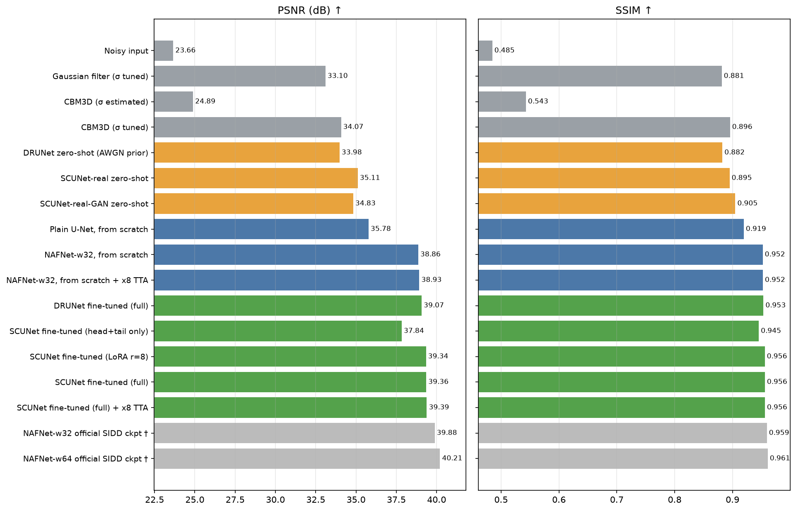
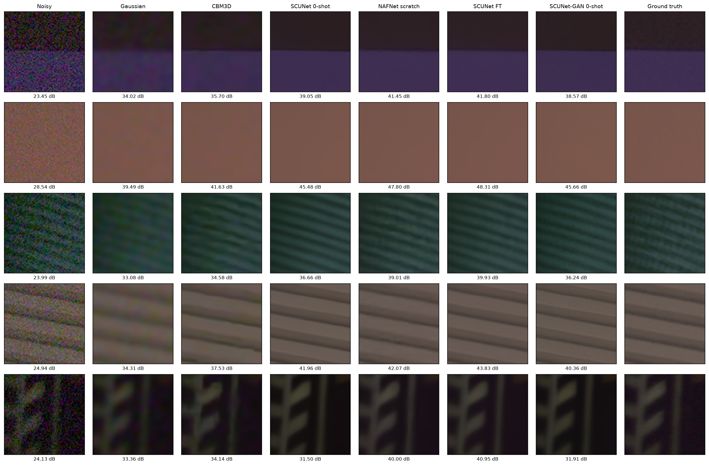
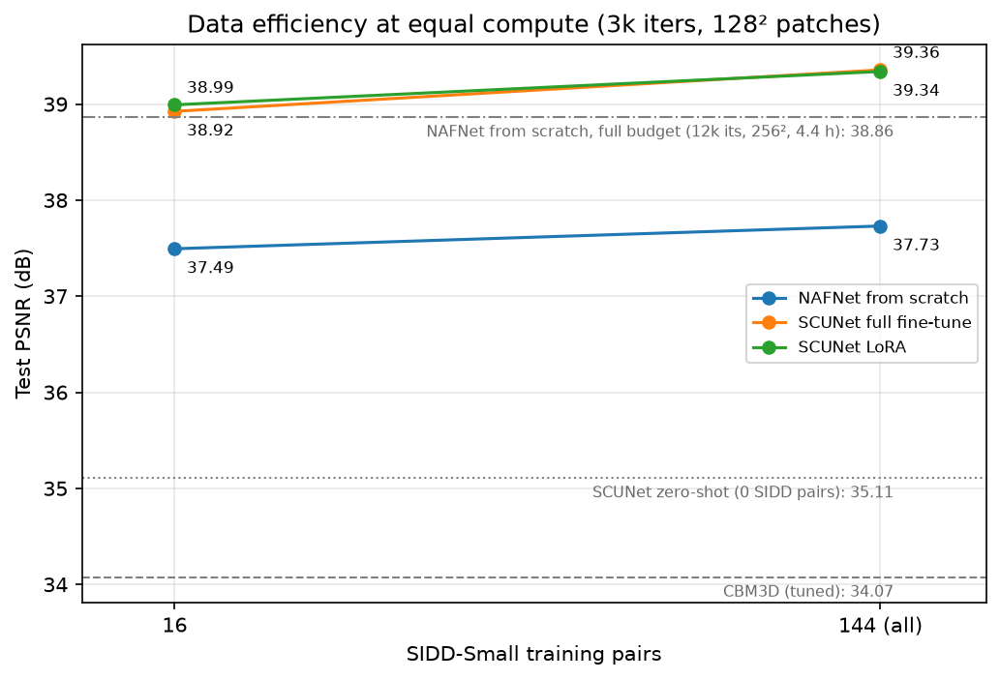
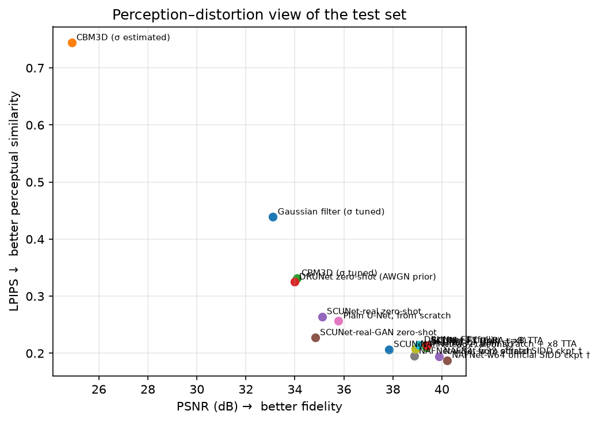

# Real-noise image denoising on SIDD

Take-home task: *train an image restoration model that beats simple baselines on PSNR/SSIM with visually convincing output, on an 8–12 GB GPU or CPU.*

I chose **denoising of real smartphone noise (SIDD sRGB)** and compared two families of models:

1. **From scratch:** NAFNet-w32, the architecture behind the strongest SIDD results that fit a small compute budget, plus a plain U-Net ablation.
2. **Transfer learning:** SCUNet, pretrained *only on synthetic realistic noise* and never on SIDD, fine-tuned three ways: full, LoRA, and head+tail only. DRUNet, pretrained on plain Gaussian noise, serves as a weaker-prior comparison.

Everything was trained on a laptop, an Apple M4 Pro using PyTorch's MPS backend. The same code runs on CUDA with fp16 autocast (`notebooks/colab_train.ipynb`).

## Results

On the 1280 official SIDD validation blocks, which were used only for scoring:

| Method | PSNR ↑ | SSIM ↑ | LPIPS ↓ | Trainable params | Train time (M4 Pro) |
|---|---|---|---|---|---|
| Noisy input | 23.66 | 0.485 | 0.792 | – | – |
| Gaussian filter (σ tuned on holdout) | 33.10 | 0.881 | 0.439 | – | – |
| CBM3D (σ estimated per image, classic protocol) | 24.89 | 0.543 | 0.744 | – | – |
| CBM3D (σ tuned on holdout) | 34.07 | 0.896 | 0.332 | – | – |
| DRUNet zero-shot (AWGN prior, σ tuned) | 33.98 | 0.883 | 0.325 | – | – |
| SCUNet-real zero-shot (synthetic realistic noise, never saw SIDD) | 35.11 | 0.895 | 0.264 | – | – |
| Plain U-Net, from scratch | 35.78 | 0.920 | 0.257 | 10.0M | 0.7 h |
| **NAFNet-w32, from scratch** | **38.86** | **0.952** | **0.195** | 29.2M | 4.4 h |
| SCUNet fine-tuned, head + tail convs only | 37.84 | 0.945 | 0.207 | 3.5K | 0.4 h |
| DRUNet fine-tuned (full) | 39.07 | 0.953 | 0.215 | 32.6M | 0.3 h |
| **SCUNet fine-tuned, LoRA r=8** | **39.34** | **0.956** | 0.213 | 1.02M (5.7%) | 0.8 h |
| **SCUNet fine-tuned (full)** | **39.36** | **0.956** | 0.210 | 17.9M | 0.75 h |
| SCUNet fine-tuned (full) + x8 self-ensemble | 39.39 | 0.956 | 0.213 | 17.9M | 0.75 h |
| *NAFNet-w32 official checkpoint †* | *39.88* | *0.959* | *0.195* | | |
| *NAFNet-w64 official checkpoint †* | *40.21* | *0.961* | *0.188* | | |

† Trained by the NAFNet authors on SIDD-Medium (a superset of our training data) for 200–400k iterations on 8 GPUs. It is a ceiling, not a competitor. SSIM is the SIDD-convention 3-D SSIM. The per-channel SSIM, DISTS, 95% CIs, GMACs and latency for every row are in `notebooks/report.ipynb` and `results/*.json`.

**Against the success criteria:** every learned model beats the Gaussian filter and tuned CBM3D on every metric. The best model gains **+6.3 dB PSNR / +0.075 SSIM over the Gaussian filter** and **+5.3 dB / +0.06 over tuned BM3D**. It is better on 40/40 test images against BM3D (paired bootstrap, p < 1e-4), and it lands within 0.5 dB of the official NAFNet-w32 checkpoint while training for 45 minutes on a laptop.




*Zoomed 96×96 centre crops of test blocks, with per-crop PSNR under each tile. The Gaussian filter blurs the blinds and leaves; CBM3D leaves blotchy low-frequency chroma noise. The fine-tuned model keeps edges and the fine stripe texture. SIDD's "ground truth" is itself an estimate and still carries some grain (row 3), which is part of why PSNR saturates around 40 dB.*

### Findings

1. **Transfer learning beats training from scratch at a fraction of the compute.**
   - Fine-tuned SCUNet reaches 39.36 dB in 0.75 h. NAFNet from scratch reaches 38.86 dB in 4.4 h.
   - The paired difference is **+0.49 dB (95% CI 0.42–0.57)**, with SCUNet better on 39 of 40 test images.
   - The prior does most of the work: zero-shot SCUNet already scores 35.1 dB, and 3k fine-tuning steps add +4.3 dB.
2. **Data efficiency.** At equal compute (3k iterations, 128² patches), the fine-tuned models trained on **16 pairs** (38.92–38.99 dB) beat NAFNet trained from scratch on all 144 pairs (37.73 dB) by +1.2 dB.
   - They are statistically tied with the 4.4 h full-budget NAFNet: +0.06 dB, CI −0.14 to +0.24.
   - Going from 16 to 144 pairs adds +0.43 dB to fine-tuning, but only +0.24 dB to training from scratch. At this budget, training from scratch is limited by compute, not by data.

   
3. **LoRA matches full fine-tuning.**
   - With 5.7% of the parameters trainable, LoRA reaches 39.34 vs 39.36 dB (difference −0.02 dB, CI −0.04 to +0.00).
   - At 16 pairs LoRA is marginally *ahead* (38.99 vs 38.92), consistent with its lower capacity to overfit.
   - Training only the first and last conv layers (3.5K parameters) already recovers +2.7 dB over zero-shot. So much of the synthetic-to-real gap is a colour and scale mismatch at the input/output, which a tiny adapter can fix.
   - The adapters merge into the base weights (`merge_lora`), so LoRA inference costs nothing extra. The GMACs figure for the LoRA row in `results/` is measured unmerged.
4. **Architecture matters more than the prior after fine-tuning.**
   - DRUNet's AWGN prior is 1.1 dB worse zero-shot, but only 0.29 dB worse after fine-tuning (39.07 vs 39.36).
   - NAFNet's blocks (LayerNorm, SimpleGate, channel attention) are worth **+3.1 dB** over a plain U-Net of similar compute (38.86 vs 35.78; better on 40 of 40 images).
5. **PSNR and perception disagree.**
   - NAFNet from scratch has *lower* PSNR than fine-tuned SCUNet but *better* LPIPS and DISTS (0.195 vs 0.210). It matches the official checkpoint on LPIPS.
   - SCUNet-real-GAN trades 0.28 dB PSNR for clearly better LPIPS (0.227 vs 0.264) at zero-shot.
   - x8 self-ensemble adds a small but significant +0.03 to +0.06 dB PSNR at 8× the inference cost, and slightly *worsens* LPIPS, because averaging smooths texture.

   

## Why these choices (a 2026 literature check)

Before designing anything I surveyed current (2024–2026) work on architectures, transfer learning and SIDD evaluation practice. Condensed:

| Question | Finding | Decision |
|---|---|---|
| Best architecture per FLOP on SIDD? | No 2025–26 model with released code clearly beats CGNet (40.39 dB) or NAFNet (w32: 39.97 dB at ~16 GMACs). Mamba-based restorers (MambaIR/v2) need CUDA-only kernels and add nothing on SIDD. | **NAFNet-w32** from scratch; plain U-Net as an ablation to measure what NAFNet's blocks buy |
| What to transfer *from*? | The public NAFNet/Restormer/CGNet SIDD checkpoints were trained on SIDD-Medium, which **contains SIDD-Small**. Fine-tuning them on SIDD-Small is circular. SCUNet's `real_psnr` checkpoint was trained purely on a synthetic realistic-noise pipeline. | **SCUNet-real** as the transfer source; **DRUNet** (AWGN) as a weak-prior control; the official NAFNet checkpoints appear only as a flagged **upper bound** |
| All-in-one / diffusion / foundation models? | All-in-one models (PromptIR, InstructIR, Perceive-IR) reach only ~24.4–24.9 dB zero-shot on SIDD. Diffusion restorers (DiffBIR, SUPIR, OSEDiff) are 1–5 B parameters, SR-oriented, and cannot be fine-tuned on this hardware. DINO/CLIP encoders add ≤0.3 dB, and not on SIDD. | Out of scope; mentioned for context |
| Parameter-efficient fine-tuning? | LoRA for restoration (CoLoRA, LoRA-IR, 2024) makes a credible, current comparison. | **LoRA (r=8)** on every Linear and non-grouped conv, next to full and head-only fine-tuning, plus a data-efficiency sweep |
| Loss / recipe? | SOTA SIDD models use pixel losses. NAFNet uses **PSNR loss** with AdamW (β=0.9, 0.9), cosine LR and no augmentation. EMA is cheap insurance. | Same recipe, with warmup and EMA |
| Evaluation pitfalls? | Quantize before scoring; RGB not Y; per-block mean; **the SIDD SSIM is MATLAB's 3-D SSIM**, not per-channel SSIM; the published BM3D number uses an *estimated* σ, which is very weak on correlated sRGB noise. | Strict protocol below; BM3D reported with both estimated and tuned σ |

## Data

| Split | Source | Use |
|---|---|---|
| Train | SIDD-Small sRGB: 144 of 160 noisy/clean pairs (12 MP each), cut into 13,752 overlapping 512² tiles; random 256² (or 128²) crops | Training |
| Holdout | 16 SIDD-Small pairs, stratified by phone (5 phones) | Early stopping, and σ tuning for the Gaussian / BM3D / DRUNet baselines |
| **Test** | The official **1280 SIDD sRGB validation blocks** (40 images × 32 blocks of 256²) | Final numbers only; never used for any decision |

SIDD has only 10 scenes, so a scene-disjoint holdout is impossible without discarding most of the data. The holdout is disjoint *by capture* (pair), not by scene.

## Evaluation protocol

Implemented in `src/sidd_denoise/metrics.py` and covered by tests:

* Outputs are clamped to [0, 1] and **quantized to uint8** before scoring.
* **PSNR** is computed in RGB, with data range 255 and no border crop, per 256² block, then averaged over all 1280 blocks.
* **SSIM** follows the SIDD/MATLAB convention: an 11×11×11 Gaussian (σ 1.5) over H, W *and* RGB with replicate borders. It is identical to NAFNet/BasicSR's `calculate_ssim`, implemented separably and unit-tested against a conv3d reference. This is the number comparable to published tables.
* **SSIM-2D** is standard per-channel SSIM (Wang et al. settings), reported as well because it is stricter.
* **LPIPS** (AlexNet) and **DISTS** (via `pyiqa`) are perceptual, full-reference metrics.
* **95% CIs** are bootstrapped over the 40 test *images*, and **paired bootstrap tests** compare models (see the report notebook).

**Protocol check:** the noisy input scores **23.66 dB** (the literature reports 23.66), CBM3D with estimated σ scores **24.89 dB** (literature: 24.89), and the official NAFNet-SIDD-w32 checkpoint scores **39.88 dB / 0.959 SSIM** against the paper's 39.97 / 0.960. The small PSNR gap is consistent with our stricter uint8 quantization.

## Repository layout

```
src/sidd_denoise/
  data.py        TileDataset (random crops, pair-level subsets), SIDDBlocks (test set), device picker
  models/        nafnet.py, scunet.py, drunet.py, unet.py: ports that load the official checkpoints strictly
                 lora.py: minimal LoRA for Linear/Conv2d with merge; __init__.py: registry + fine-tune modes
  losses.py      PSNR loss (fp32), Charbonnier, L1
  train.py       AdamW + warmup/cosine, EMA, CUDA AMP, holdout validation, resumable checkpoints
  evaluate.py    test-set scoring, x8 self-ensemble, FLOPs/latency, per-block arrays + visuals
  metrics.py     PSNR, 3-D and 2-D SSIM, LPIPS, DISTS, bootstrap CIs, paired tests
  baselines.py   Gaussian filter, CBM3D
  report.py      tables and figures for the report notebook
scripts/         download_sidd.py, download_weights.py, prepare_patches.py, run_baselines.py,
                 zero_shot.py, train.py, evaluate.py, run_all.sh (the whole queue)
configs/         YAML per experiment (inherit from base.yaml; override anything with --set a.b=value)
notebooks/       report.ipynb (renders every result; no inference), colab_train.ipynb
tests/           22 tests: model shapes, SDPA == upstream attention, LoRA zero-init and merge,
                 metrics vs references, data pipeline, a training smoke test with resume
```

## Reproduce

```bash
uv venv -p 3.13 && uv pip install -e ".[dev,extra]"      # or: pip install -e ".[dev,extra]"
python scripts/download_sidd.py         # ~7 GB, parallel range requests (York server is slow)
python scripts/download_weights.py      # SCUNet / DRUNet (KAIR release), NAFNet reference ckpts
python scripts/prepare_patches.py       # 512² tiles + train/holdout index (~10 GB)
pytest                                   # 22 tests
bash scripts/run_all.sh                  # baselines, zero-shot, all training runs, evaluation
jupyter nbconvert --execute --to notebook --inplace notebooks/report.ipynb
bash make_zip.sh                         # deliverable zip (no data, weights or checkpoints)
```

Single run: `python scripts/train.py --config configs/scunet_ft_lora.yaml --set data.num_pairs=16`, then
`python scripts/evaluate.py --ckpt runs/<name>/best.pt --name <name> [--tta] [--dists]`.

## Training recipe

| | From scratch (NAFNet-w32, U-Net) | Fine-tuning (SCUNet, DRUNet) |
|---|---|---|
| Loss | PSNR loss (NAFNet), computed in fp32 | same |
| Optimizer | AdamW, lr 1e-3, β (0.9, 0.9), wd 0; U-Net lr 5e-4, β (0.9, 0.999) | AdamW, lr 5e-5 (full) / 5e-4 (LoRA, head+tail), β (0.9, 0.999) |
| Schedule | 500-iteration warmup, cosine to 1e-7, 12k iterations | 100-iteration warmup, cosine, 3k iterations |
| Batch / patch | 8 × 256² random crops, no flips/rotations (as NAFNet) | 8 × 128² |
| Extras | EMA 0.999 (evaluated), grad-clip 1.0, best checkpoint by holdout PSNR | same |
| Precision | fp32 on MPS; fp16 autocast + GradScaler on CUDA | same |

## Compute and engineering notes

* **Budget.** Everything ran on one M4 Pro (MPS). The full queue (`scripts/run_all.sh`) took ~11 h wall-clock unattended. Measured step times at batch 8: NAFNet-w32 1.3 s at 256², SCUNet 0.83 s at 128², U-Net 0.27 s at 256². MPS gave no speedup from fp16/bf16 autocast or channels-last, so training stays in fp32. The recipe was therefore trimmed from the plan: NAFNet gets 12k iterations instead of the paper's 200k, and fine-tunes use 128² crops. At this length NAFNet is still improving (see the training curves), so 38.86 dB understates it. `notebooks/colab_train.ipynb` runs the same queue on a CUDA GPU, where longer schedules are affordable.
* **Ports verified against the originals.** NAFNet, SCUNet and DRUNet load the official checkpoints with `strict=True`, and the official NAFNet-SIDD checkpoint reproduces the paper.
  * SCUNet's windowed attention was rewritten with fused `scaled_dot_product_attention`, folded to 4-D because the MPS kernel rejects 5-D inputs. A unit test checks it against the upstream einsum/softmax code.
  * The released SCUNet real-noise checkpoints use `config=[4]*7`, not the repo's default `[2]*7`.
* **Metric engineering.**
  * The SIDD-style 3-D SSIM is computed as three separable 1-D passes, identical to BasicSR's conv3d version (unit-tested) but orders of magnitude faster on CPU (under 1 s vs over 10 min for 64 blocks).
  * LPIPS and DISTS run on MPS: identical values to about 1e-6, and 8–60× faster than on CPU.

## Limitations and honest caveats

* **Holdout vs test.** Test blocks are noisier (23.7 dB input PSNR) than the SIDD-Small holdout (27.8 dB). The Gaussian, BM3D and DRUNet σ values were tuned on the milder holdout, which slightly favours small σ. Re-tuning on the test set would be leakage, so I did not do it.
* **Shared scenes.** SIDD has 10 scenes, and the test images share scenes (but not captures) with training. This is standard for SIDD validation numbers, but it does not measure generalization to new scenes or phones. The MIDD dataset (CVPR 2024) found that SIDD-trained models over-smooth on other phones.
* **Ablation differences.**
  * The U-Net was given a lower learning rate than NAFNet (5e-4 vs 1e-3). I chose it up front because the U-Net has no LayerNorm, and did not test whether 1e-3 would be stable, so the two recipes differ in LR and β.
  * The DRUNet fine-tune initialised its learnable noise level at σ = 25, not at the holdout-tuned zero-shot value of 50, and σ barely moved (24.8). The effect is probably small after 3k steps of full fine-tuning, but it was not ablated.
  * A PSNR-loss vs L1 ablation (`configs/nafnet_w32_l1.yaml`) is prepared but did not fit the budget.
* **Single seed.** Each configuration was trained once. The CIs cover test-set sampling, not training randomness. Gaps smaller than about 0.1 dB (LoRA vs full, TTA gains) should be read with that in mind.

## What I would do next

1. **Longer schedules on a GPU.** Run NAFNet-w32 at 40k+ iterations with batch 16, and fine-tune SCUNet at 256² crops. Both curves are still rising.
2. **Distillation.** Use fine-tuned SCUNet (or CGNet) as a teacher for a ~2M-param NAFNet student, which recent mobile-denoising work shows loses only ~0.05 dB.
3. **Better synthetic-to-real pretraining.** Give NAFNet the same synthetic realistic-noise pretraining SCUNet had. Then architecture and prior would no longer be confounded in finding 1.
4. **Cross-dataset testing** on DND or PolyU, to measure generalization beyond SIDD's scenes.
5. **Deblurring (GoPro).** The same package applies with a different dataset class. NAFNet's GoPro checkpoints are available for the transfer setup.
